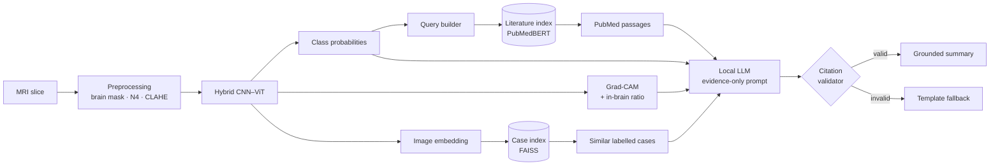

# brain-mri-rag
# Retrieval-Augmented Brain MRI Assistant

**Explainable brain-tumour MRI classification with leakage-free evaluation, similar-case retrieval and citation-grounded summaries.**

[](https://github.com/<your-username>/brain-mri-rag/actions)


> **Research prototype. Not a medical device and not for clinical use.** Outputs are meant for methodological research only and must not inform patient care.

---

## Overview

This project classifies 2-D brain MRI slices into **glioma, meningioma, pituitary tumour or no tumour**. Every prediction comes with three kinds of evidence a reviewer can check:

1. **Where the model looked.** A Grad-CAM heat map, plus a number saying how much of that attention falls *inside the brain*.
2. **What it resembles.** The most similar labelled reference scans, retrieved from a vector index of the training set.
3. **What the literature says.** Passages retrieved from PubMed abstracts. A local LLM writes a short summary that may cite only those passages, and every citation is checked automatically.

It extends my earlier work on hybrid CNN–Vision Transformer models for brain-tumour MRI ([Monim et al., 2026](#related-publication)). It fixes the weaknesses that study exposed, and it adds retrieval augmentation.

## Highlights

- **Leakage-free evaluation.** Perceptual-hash de-duplication and group-aware stratified splits. A data audit reports how many of the public dataset's own *test* images also appear in its *training* folder.
- **Anatomy-aware preprocessing.** Brain masking, optional N4 bias correction, robust intensity normalisation and CLAHE. These remove the eye-socket and skull shortcuts that heat maps revealed in the earlier study.
- **Hybrid CNN–ViT with cross-attention fusion.** A ResNet-50 local-texture branch and a ViT-B/16 global-context branch, fused by multi-head cross-attention. It is benchmarked against ResNet-50, EfficientNet-B0 and ViT-B/16.
- **Honest statistics.** Five training seeds per model, mean ± SD, and bootstrap 95% confidence intervals.
- **Quantified explainability.** The Grad-CAM *in-brain ratio* is reported for every model. On BraTS-style data with tumour masks, the pointing-game and IoU metrics are supported too.
- **Two retrieval systems.** Similar-case image retrieval (FAISS) and biomedical literature retrieval (PubMedBERT embeddings).
- **Guard-railed generation.** A local LLM (Ollama) runs, so no data leaves the machine. Citation validation is followed by an automatic fallback to a deterministic template if any reference is fabricated.
- **Reproducible engineering.** Config-driven, unit-tested, with CI, Docker and a one-command pipeline (`make all`).

## System architecture



## What this fixes from the original study

| Issue observed in the earlier study | What this project does |
|---|---|
| Random split on a dataset with known duplicates | dHash de-duplication + group-aware splits; leakage quantified in `results/data_audit.md` |
| Grad-CAM focused on orbits and nasal cavity | Brain masking before training; *in-brain ratio* reported as a metric |
| Single training run, single number reported | 5 seeds, mean ± SD, bootstrap 95% CI |
| Validation loss diverged while accuracy was reported | Early stopping on validation AUC; train/val curves saved for every run |
| Few baselines | Same pipeline for ResNet-50, EfficientNet-B0 and ViT-B/16 |

## Data

| Dataset | Use | Access |
|---|---|---|
| [Brain Tumor MRI Dataset](https://www.kaggle.com/datasets/masoudnickparvar/brain-tumor-mri-dataset) (Nickparvar, 2021) | Training and evaluation, 4 classes | Free Kaggle account |
| [BraTS](https://www.synapse.org/brats) (optional) | External test of Grad-CAM localisation using tumour masks | Free registration |
| PubMed abstracts via [NCBI E-utilities](https://www.ncbi.nlm.nih.gov/books/NBK25501/) | Literature corpus for retrieval | Public |

See [`data/README.md`](data/README.md) for download steps. No data is redistributed in this repository.

## Method

### 1. Preprocessing (`src/brainrag/preprocessing.py`)
The steps run in this order:
1. Otsu thresholding.
2. Morphological opening, which cuts the thin bridges between the skull or orbits and the brain.
3. Keeping the largest connected component.
4. Filling holes and lightly eroding the mask.
5. Optional N4 bias-field correction (SimpleITK).
6. Percentile intensity normalisation inside the brain.
7. CLAHE.
8. Cropping to the brain, square padding and resizing to 224 × 224.

### 2. Leakage control (`src/brainrag/dedup.py`, `splits.py`)
A 64-bit difference hash is computed on each raw image. Images within a Hamming distance of 4 are linked into duplicate groups using union-find. Groups whose members carry conflicting labels are dropped. Train, validation and test splits (70/15/15) are made with `StratifiedGroupKFold`, so near-duplicates never cross splits. This is enforced by an assertion.

### 3. Model (`src/brainrag/models.py`)
- **CNN branch:** ResNet-50 up to `layer3`, giving a 14 × 14 × 1024 map projected to 768-d tokens.
- **ViT branch:** ViT-B/16, giving a CLS token plus 196 patch tokens.
- **Fusion:** the ViT CLS token attends over the CNN tokens using 8-head cross-attention, with a residual connection and LayerNorm.
- **Head:** the CNN pooled features, ViT CLS token and fused vector are concatenated (2,304-d) and passed to an MLP head. The same 2,304-d vector is the retrieval embedding.

Training uses AdamW with a one-cycle learning-rate schedule, label smoothing of 0.1, light augmentation and early stopping on validation macro-AUC.

### 4. Explainability (`src/brainrag/gradcam.py`, `metrics.py`)
Grad-CAM is applied to the CNN branch. The *in-brain ratio* is the share of heat-map energy inside the brain mask, and it is reported on 300 test images per run. With lesion masks (BraTS), the pointing game and IoU at the 90th percentile are also computed.

### 5. Retrieval (`src/brainrag/retrieval.py`)
- **Cases:** training-set embeddings are stored in a cosine-similarity FAISS index, with an exact NumPy fallback. Retrieval precision@5 is reported, along with a check that no neighbour comes from the query's own duplicate group.
- **Literature:** PubMed abstracts are split into 3-sentence overlapping windows and embedded with `pritamdeka/S-PubMedBert-MS-MARCO`, with a TF-IDF fallback.

### 6. Grounded summary (`src/brainrag/rag.py`)
The LLM never sees the image. It receives only structured evidence: the probabilities, the in-brain ratio, the labels and similarities of similar cases, and numbered passages. It must cite every factual sentence. The validator rejects any citation number that does not exist and falls back to a deterministic template, so a fabricated reference is never shown. Every output begins with a not-for-clinical-use notice.

## Results

<!-- RESULTS:START -->
| Model | Seeds | Accuracy (%) | Balanced acc. (%) | Macro-F1 | Macro-AUC | Grad-CAM in-brain ratio | Retrieval P@5 |
|---|---|---|---|---|---|---|---|
| Hybrid CNN-ViT (ours) | – | *pending* | *pending* | *pending* | *pending* | *pending* | *pending* |
| ResNet-50 | – | *pending* | *pending* | *pending* | *pending* | *pending* | *pending* |
| EfficientNet-B0 | – | *pending* | *pending* | *pending* | *pending* | *pending* | *pending* |
| ViT-B/16 | – | *pending* | *pending* | *pending* | *pending* | – | *pending* |

_This table is filled automatically by `scripts/aggregate_results.py` after training. No numbers are reported until they are produced by the code in this repository._
<!-- RESULTS:END -->

See also `results/data_audit.md` for the dataset leakage audit.

<!-- After running `python scripts/make_figures.py`, uncomment:


-->

## Quick start

```bash
git clone https://github.com/<your-username>/brain-mri-rag.git
cd brain-mri-rag
python -m venv .venv && source .venv/bin/activate
pip install -r requirements.txt

# 1. data: download the Kaggle dataset into data/raw (see data/README.md)
python scripts/prepare_data.py                      # preprocess, de-duplicate, split, audit

# 2. train + evaluate (5 seeds x 4 models; GPU recommended)
python scripts/train.py --model hybrid --seed 0     # or: make train
python scripts/aggregate_results.py                 # fills the README results table

# 3. retrieval indices
python scripts/build_case_index.py --model hybrid --seed 0
python scripts/fetch_literature.py                  # PubMed abstracts
python scripts/build_literature_index.py

# 4. demo (optional local LLM: `ollama pull llama3.1:8b`)
python app/gradio_app.py --checkpoint runs/hybrid/seed0/best.pt
```

To smoke-test quickly, run `python scripts/train.py --model resnet50 --seed 0 --epochs 1`. Run the tests with `pytest -q`.

## Repository structure

```
brain-mri-rag/
├── app/gradio_app.py            # interactive demo
├── configs/default.yaml         # all hyper-parameters and paths
├── data/README.md               # dataset download instructions
├── docs/                        # methodology, model card, showcase notes
├── scripts/                     # prepare → train → index → aggregate → figures
├── src/brainrag/
│   ├── preprocessing.py         # brain masking, N4, CLAHE
│   ├── dedup.py, splits.py      # leakage control
│   ├── models.py                # hybrid CNN–ViT + baselines
│   ├── gradcam.py, metrics.py   # explainability + evaluation
│   ├── retrieval.py             # FAISS / PubMedBERT indices
│   ├── rag.py                   # evidence-only prompting + citation validation
│   └── pipeline.py              # end-to-end inference
└── tests/                       # unit tests (run in CI)
```

## Limitations

- **2-D slices from a public collection.** There are no patient identifiers, so de-duplication groups *images*, not *patients*. Different slices of the same patient may still fall in different splits.
- **Heuristic brain masking.** The 2-D masking is a heuristic. For 3-D volumes, use a dedicated skull-stripping tool such as HD-BET or SynthStrip.
- **Grad-CAM is coarse and partial.** It shows which regions mattered to the CNN branch, not why the model decided as it did.
- **Small literature corpus.** The corpus is PubMed abstracts only, and an LLM summary can still misstate a correctly cited source. Citation validation checks that references exist, not that every claim is supported.
- **Single source.** Performance on a single public dataset does not establish clinical validity. External, multi-site evaluation is required.

## Responsible use

This software is not a medical device. It has not been reviewed by any regulatory body, and it must not be used for diagnosis or treatment decisions. The LLM runs locally by default, so images and derived data are not sent to third-party services. Do not process identifiable patient data without appropriate approvals.

## Related publication

R. M. Monim, K. Islam, S. M. Asad, M. A. Hussain, B. Hossen, M. T. A. Manjar, S. Sultana. *Generative AI for Early Disease Detection: Hybrid ViT-CNN with Multi-Head Attention in Medical Imaging.* Journal of Information Systems Engineering and Management, 11(2s), 2026.

This repository is an independent re-implementation and extension, not the original study code.

## Citation

If you use this code, please cite it using [`CITATION.cff`](CITATION.cff) (GitHub shows a "Cite this repository" button).

## Author

**Raiyan Muntasir Monim**: machine learning for healthcare, clinical data analysis and medical image analysis.
[LinkedIn](https://www.linkedin.com/in/<your-profile>) · [Google Scholar](https://scholar.google.com/<your-profile>) · [ORCID](https://orcid.org/<your-orcid>)
